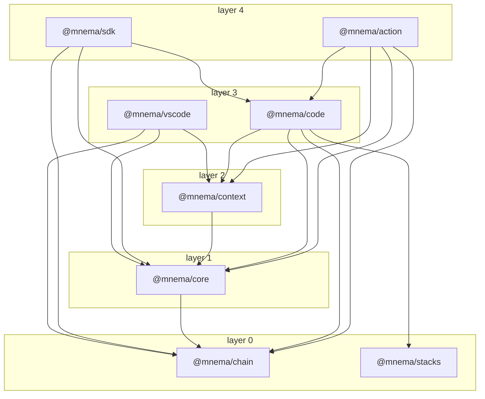

# Architecture

How the code is laid out, for someone about to change it. It says where things live and where each main flow goes through the code; it does not say what a command does for a user ([How it works](how-it-works.md) and the [command reference](cli-reference.md) do), nor what is proven ([What it proves](what-it-proves.md)).

## The packages and their layers

A package is in layer 0 when it imports no other package of this repository, and one layer above the highest package it imports otherwise. The graph is drawn from the imports in `packages/*/src` (tests left out, imports that only a type uses kept), so it moves when the code does, and a case fails when this page does not hold what the script prints. To redraw it, run `node .github/the-architecture-page/graph.mjs`. An arrow runs from a package to a package it imports.

<!-- the-import-graph:begin -->
<!-- Generated by `node .github/the-architecture-page/graph.mjs` from the imports under packages/*/src. Do not edit by hand. -->

<!-- the-import-graph:end -->

What each is for:

- **`@mnema/chain`** ([`packages/chain`](../packages/chain)): the record's format and its cryptography. Writing a tail, the two readers' shared rules, keys, the event catalog. [`FORMAT.md`](../packages/chain/FORMAT.md) is the specification, and `packages/chain/verifier` is the second reader, in Python, that imports nothing of the product.
- **`@mnema/core`** ([`packages/core`](../packages/core)): the domain over the chain. Where each tree lives (`topology/`), the operations that write decisions, tasks and notes (`workflow/`, `knowledge/`), identity and membership, and the projection cache that reads fold the record into.
- **`@mnema/context`** ([`packages/context`](../packages/context)): read-only derivations over the projection: the brief, search, focus, and which rules govern an address.
- **`@mnema/stacks`** ([`packages/stacks`](../packages/stacks)): the contract of a stack archive (manifest, validation, digest). A library with no dependency on the others.
- **`@mnema/code`** ([`packages/code`](../packages/code)): the product. The command line (`wiring/` declares each verb, `commands/` holds what it does), the MCP server (`mcp/`), the hook verbs, `init/`, and the page `mnema site` writes.
- **`@mnema/sdk`**, **`@mnema/action`**, **`@mnema/vscode`**: a library door to the record and its hooks, the GitHub Action, and the VS Code extension, which runs the `mnema` command and reads its `--json`. None is published.
- **`plugin/`**: the files a host loads (hooks, the MCP launcher, skills); the hooks are scripts that call the `mnema` binary, not packages.

## What is on disk

A record is three places, and what each holds decides what a clone receives.

- **The public tree, `.mnema/` in the repository, committed.** `tails/<fingerprint>-<installation>/` holds a tail: `000001.jsonl` and later segments (a segment is sealed at 4 MiB), `checkpoints.jsonl`, `tailproof.json`, and `witness/`. `keys/<fingerprint>.pub` is a public key. `keys/*.inst` and `keys/*.anchor` are local and ignored, as are the writer's private files in `locks/` and the page in `site/`. [`layout.ts`](../packages/chain/src/chain/layout.ts) draws the layout; [`tree.ts`](../packages/chain/src/chain/tree.ts) writes the `.gitignore` and `.gitattributes`.
- **`locks/`, inside that tree and ignored.** Machinery, never proof: `<tail>.lock` (held while a writer appends), `<tail>.head` (the last entry this installation wrote), `<tail>.head.sig` (the same entry, signed, with what it was chained onto and what an append is about to write), `<tail>.cited` (heads of other tails already cited), and `projection.db`, the cache reads keep. [`kept-head.ts`](../packages/chain/src/chain/kept-head.ts) says what the notes are for; losing one costs a rebuild, a repeated citation or at worst a new tail, never a proof.
- **The private tree, `.git/mnema/<encoded path>/private/`.** Inside a git repository it lives under the common git directory, so `git add` cannot reach it ([`privateTreeUnder`](../packages/core/src/topology/git-place.ts)); outside one it is `.mnema/private/`. Same tail layout.
- **`~/.mnema`, or `$MNEMA_HOME`.** `identity/` is the key root (the private key, never copied into a tree, and the cold backup key), `global/` is the tree for this machine across projects, `agents/<name>/` holds an agent's key root, and `sessions/` holds the session journal. [`appDataDir`](../packages/core/src/topology/resolve.ts) names it.

A stored line is `{"event": ..., "link": {hash, prev, seq, tail}}`; the format, the canonical bytes and the checkpoint scheme are in [`FORMAT.md`](../packages/chain/FORMAT.md).

## The main flows

Each step names the function where it happens; the link goes to its definition. A line anchor can go stale when code above it moves: a case fails when a link points at no file, at a line past the end of one, or at a line that does not hold the name it is labelled with.

### A write: recording a decision

1. [`runDecision`](../packages/code/src/commands/decision.ts#L102) is what `decision record` runs. [`treesToWrite`](../packages/code/src/commands/write-as-the-agent.ts#L56) finds the trees ([`resolveTrees`](../packages/core/src/topology/resolve.ts#L204)) and applies an agent's key where there is one.
2. [`resolveScope`](../packages/core/src/topology/routing.ts#L252) says which tree the kind goes to (a decision goes to the public one), and [`openTreeForWriting`](../packages/core/src/topology/routing.ts#L322) chooses the key that signs, makes the tree, and opens the chain ([`openChainForWriting`](../packages/chain/src/chain/chain.ts#L75)).
3. [`exclusively`](../packages/chain/src/chain/writer.ts#L634) runs the act under the tail's lock ([`underTailLock`](../packages/chain/src/chain/writer.ts#L468)). When the tail's files moved since this writer last held the lock, [`recover`](../packages/chain/src/chain/writer.ts#L763) reads where the tail ends and decides whether this installation may go on writing it or must start a new tail.
4. [`recordDecision`](../packages/core/src/workflow/decision-operations.ts#L190) screens the text, reads the record as it stands ([`onTheRecordAsItStands`](../packages/core/src/workflow/as-the-record-stands.ts#L90)) to number it and to see whether the same decision is already there, and [`appendFacts`](../packages/core/src/workflow/append.ts#L222) builds the events: `decision.recorded` and the move to `proposed`.
5. [`appendAllLocked`](../packages/chain/src/chain/writer.ts#L1040) refuses a damaged tail, cites other tails' heads, gives the tail its first files, seals each entry ([`sealEntry`](../packages/chain/src/chain/entry.ts#L154)) and appends it durably. Before the line it keeps the signed note of the end it chains onto ([`keepIntent`](../packages/chain/src/chain/writer.ts#L575)), so a kill between the line and the end of the act leaves an end the next write can vouch for.
6. The command then calls [`checkpoint`](../packages/chain/src/chain/writer.ts#L1170), which signs what is above the last checkpoint ([`signLocked`](../packages/chain/src/chain/writer.ts#L1192)); leaving the lock keeps the notes ([`keepHeadIfWritten`](../packages/chain/src/chain/writer.ts#L595)).
7. Nothing updates the projection at write time. The next read's [`refresh`](../packages/core/src/projections/cache.ts#L476) advances it from the new lines, or replays the whole record when it cannot prove they are a suffix.

Through MCP the tool `record_decision` ([`mutatesTheRecord`](../packages/code/src/mcp/server.ts#L1330)) calls [`runRecordDecision`](../packages/code/src/mcp/tools.ts#L935), which routes the write to a project and reaches the same [`recordDecision`](../packages/core/src/workflow/decision-operations.ts#L190) and the same writer.

### Verify

1. [`registerVerify`](../packages/code/src/wiring/verify.ts#L376) declares `mnema verify` and its options; [`runVerify`](../packages/code/src/commands/verify.ts#L189) covers the public tree, the private one, and the global one on request.
2. [`verify`](../packages/chain/src/chain/chain.ts#L134) calls [`verifyChain`](../packages/chain/src/chain/verify.ts#L1206), which reads each tail in [`verifyReading`](../packages/chain/src/chain/verify.ts#L1295): the hash chain ([`verifyHashChain`](../packages/chain/src/chain/verify.ts#L2338)), then the checkpoints and their signatures against the committed keys ([`verifyCheckpoints`](../packages/chain/src/chain/verify.ts#L2431)), then who was a member of the identity at each point. A tail that is a symbolic link is refused by name ([`linkedTail`](../packages/chain/src/chain/verify.ts#L1707)).
3. The level reached is named by [`level.ts`](../packages/chain/src/chain/level.ts); `--require` is the level that makes the exit code non-zero.
4. The second reader, [`main`](../packages/chain/verifier/mnema_verify.py#L125), reads the same files with its own code and must agree; the `second-reader-*` cases in `packages/chain/src/chain/` hold that. The page `mnema site` writes ([`runSite`](../packages/code/src/commands/site.ts#L171)) embeds the same TypeScript `verifyChain`, so a browser runs the first reader, not the Python one.

### The rules before an edit

1. In Claude Code, [`hooks.json`](../plugin/hooks/hooks.json) declares a `PreToolUse` hook on `Write|Edit|NotebookEdit` that calls the MCP tool `rules_before_an_edit` ([`mutatesTheRecord`](../packages/code/src/mcp/server.ts#L2028)), which reaches [`rulesBeforeAnEdit`](../packages/code/src/mcp/tools.ts#L3005).
2. [`whatAWriteMeets`](../packages/code/src/what-a-write-meets.ts#L241) is the one place that decides: a refusal first ([`readRefusesAWriteAt`](../packages/code/src/governed-tree.ts#L254), over the rules [`refusesAWriteAt`](../packages/context/src/intelligence/governance.ts#L1011) finds by address), and only when nothing refuses, whether a person is asked.
3. The reply is shaped for the host by [`hookReply`](../packages/code/src/mcp/hook-reply.ts#L212); a refusal is recorded with [`recordTheCharge`](../packages/code/src/what-a-write-meets.ts#L422).
4. The other hosts run a command hook: [`edit-refuses-a-write.mjs`](../plugin/hooks/edit-refuses-a-write.mjs) calls [`whatTheGateAnswers`](../plugin/hooks/hand-over.mjs#L527), which spawns the `before-a-write` verb ([`runBeforeAWrite`](../packages/code/src/commands/before-a-write.ts#L143), then [`whatAPathMeets`](../packages/code/src/commands/before-a-write.ts#L214)) and answers in the host's own shape ([`replyFor`](../packages/code/src/host-hook.ts#L224)). When `mnema` is there but does not answer (it exits non-zero, times out, or prints no reply) and a rule reaches the path, the hook denies; with no `mnema` at all it stays silent and the write goes through.

### Committing the record

[`runRecordCommit`](../packages/code/src/commands/record-commit.ts#L540) (`mnema record commit`) writes nothing to the working tree, the index or `HEAD`. It cuts each tail at a checkpoint, never below what the base branch already holds, copies those files and the public keys they cite into a tree built with git plumbing in a scratch index, verifies that tree in a temporary repository (`verify --require signed`, and `--since` the base), and only then makes the commit on a `mnema-record/` branch. It pushes nothing; it prints the commands.

### The merge driver

1. [`tree.ts`](../packages/chain/src/chain/tree.ts) writes the `.gitattributes` line that names the driver ([`TAIL_MERGE_DRIVER`](../packages/chain/src/chain/tree.ts#L100)) for `tails/*/*.jsonl`. The git configuration that makes git call it is written by `mnema init` when asked, or by [`fixMergeDriver`](../packages/code/src/commands/doctor-merge-driver.ts#L259); without it git merges the files as text.
2. Git runs `record merge-tail` ([`merge-tail`](../packages/code/src/wiring/record.ts#L276), then [`mergeTailFiles`](../packages/code/src/commands/record-merge-tail.ts#L69)).
3. [`joinGrownTail`](../packages/code/src/commands/record-merge-tail.ts#L47) keeps the longer side when one is a byte prefix of the other, which is a tail that only grew. Anything else is a fork: it exits 1 and leaves our side untouched.
