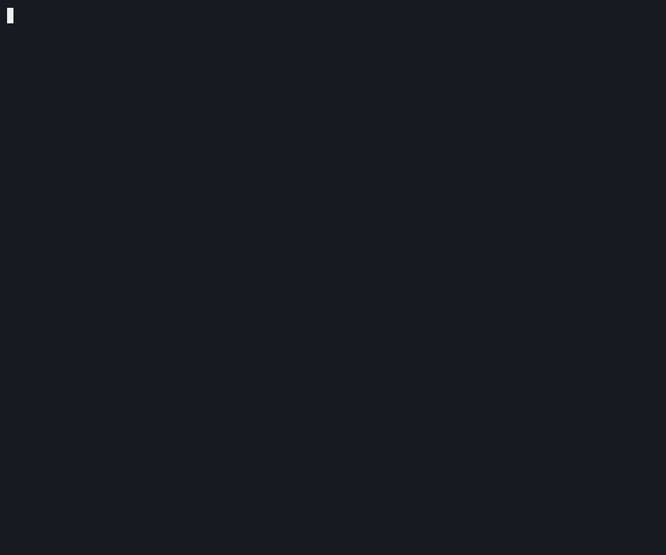

# What it proves, and what it does not

<!-- description: What mnema verify proves about a record, a hash chain and signed checkpoints, and what it does not. -->

Being exact about this is what the product is for, so it is the section worth
reading twice. `mnema verify` reads the events and the committed public keys of
a project's trees (no private key, no network) and prints each verdict
verbatim. The surfaces never turn a verdict into a stronger claim than it is.

**What holds.** A hash chain over every entry, so a changed or reordered event
breaks it; Ed25519 checkpoints over a root recomputed from event *content*, so an
edit made without the signing key is caught, where the checkpoints remain, even if
the keyless hashes are recomputed (`--require=signed` fails when they were taken out, and from this version on the key holder's next write does not sign them back in: a writer signs only the events its own installation wrote, as a note signed with its key vouches, while every mnema that writes with that key is this version or later); and a committed public key that verification re-derives from the key
material it loads, so swapping the committed key for another is caught too. The
verdict names the **level** it reached rather than saying yes or no.

*One word of an accepted decision, changed by hand: `verify` fails and exits 1. A cut that takes the newest events together with their checkpoint would not be caught: a hash chain shows what changed, never what is gone. The script that made it is [`recordings/a-tamper-caught.sh`](../recordings/a-tamper-caught.sh).*

**What does not hold, stated as plainly as the rest.**

| The claim somebody will read into it | What actually holds |
|---|---|
| **Every event is signed** | Every write the product makes leaves the record signed up to a checkpoint ([`every-write-signs-what-it-wrote.test.ts`](../packages/code/tests/every-write-signs-what-it-wrote.test.ts)), but a reader is guaranteed only up to the last checkpoint: events written after it rest on the hash chain alone, and `verify` reports that separately instead of folding it into a pass. |
| **Nothing was removed** | Not proven locally, and it cannot be: a hash chain shows what changed, never what is gone, and a tail deleted together with its key, while another remains, leaves nothing on disk to cross; a record left with no tail holding anything is refused by name, exit 1. Committing the record to a git remote is what preserves the files a deletion would take. On the machine that wrote a tail, its newest entries cut together with their checkpoints and the clear note in `locks/` set back are not written over: the note signed with the tail's key still names the entry it wrote last, so the next write goes to a new tail and says which entries are not there. That proves nothing to a clone, and it is gone with `locks/`. |
| **The record is who it says it is** | No. A record forged whole (deleted and refounded under a fresh key, with the opposite decision written into it) verifies clean and word for word like an honest one, and the [second reader](verify-without-installing.md) cannot tell them apart either. What would distinguish them is not in the record for any reader to find. Where somebody asked, `verify --against-github` compares the signing keys with the SSH keys the GitHub account each identity named publishes: that says an account publishes the key *today*, not that it was the account's when it signed, and only on github.com's word. |
| **The record is as old as it says** | Only where somebody asked for it. `mnema witness stamp` has the public OpenTimestamps calendars attest a checkpoint's digest, so a chain rebuilt this morning cannot claim a history; what leaves the machine is a hash of that digest joined to a random nonce, and nothing else of the record; it is opt-in, and a record nobody stamped reads `not covered`. |
| **A Sigstore signature names the person** | It names an e-mail, not a GitHub login: whoever could sign in with that verified address countersigned the checkpoint (`mnema witness sigstore`). In GitHub Actions it names a workflow of a repository, not a person. It speaks for an identity of the record only where that identity named the same address in a signed, covered fact (`mnema key sigstore`), and `verify --against-sigstore` says whether it did. |
| **A Sigstore bundle dates the checkpoint** | On the word of Sigstore's log: the time is Rekor's, or a timestamp authority's on a Rekor v2 entry, which carries none of its own, and the entry sits in a public log anybody can audit, not the Bitcoin work behind `witness stamp`, which is why it is no witness level and `--require witnessed` does not count it. It dates that checkpoint and every one below it; events written after are counted, not dated. |
| **A Sigstore bundle names the agent, or the model, that worked in the run** | No. From a GitHub Actions job the certificate also names the repository, the workflow, the commit and the run, and `verify --against-sigstore` prints those four from the extensions Fulcio wrote into a certificate Sigstore's own checks accepted (`packages/code/src/sigstore/sigstore.test.ts`). It names a run, not the agent inside it: who started the run is not the agent that worked there, and nothing in the certificate says which agent or model that was. A certificate for an e-mail names no run. The [second reader](verify-without-installing.md) names each bundle and checks neither its certificate nor these four names. |
| **Whoever holds the e-mail wrote the record** | No. Anybody can countersign the digest of a checkpoint they can compute, which is any checkpoint of a public repository. Without the record's own claim, a bundle dates the checkpoint and says nothing about who wrote it. |
| **What leaves the machine, and when** | For the stamp, a hash of a checkpoint's digest joined to a random nonce, and nothing else of the record. With the Sigstore countersignature, where somebody ran it, the digest itself leaves, and the identity by design: the e-mail, or the repository, the workflow, the commit and the run, goes into a public log that does not forget, and into the committed bundle. In GitHub Actions the act refuses a private repository. |
| **The record does not keep my e-mail** | It keeps its hash: `mnema key sigstore` writes the SHA-256 of the address (`sha256:<hex>`, trimmed and in lower case), never the address. The hash protects the record and nothing else: the committed bundle and Sigstore's public log name the address itself. And it is no secret from somebody who already suspects the address: they hash their guess and compare. |
| **Checking a Sigstore bundle needs the network** | Signing does; reading does not. `verify --against-sigstore` checks against the trust root this binary carries, so a bundle signed after Sigstore turns its keys over reads `not covered` on an older binary: never verified. The [second reader](verify-without-installing.md) names each bundle and does not check it. |
| **A signed and countersigned record is honest** | Whoever holds the key and the e-mail can rebuild the record and countersign it again; the date is then the date of the rebuild, which is what exposes it. Omission stays uncovered, as everywhere else. |
| **A green `verify` means the record is honest** | It means nothing *verifiable* is broken. The default rules on the hash chain, which a crude edit fails and a patient rebuild passes: `--require=signed` catches checkpoints taken out from under the events they signed, and it is one flag, not extra work; the [second reader](verify-without-installing.md) takes `--require signed` too, and has no `--require witnessed`. It does not catch a cut that took the newest events together with their checkpoint: what is left is a shorter record honest in every byte, and only a copy from before the cut, the history a git remote keeps, shows it was longer; `verify --since <rev>` holds the record to that copy, and the [Action](../packages/action/) asks it of every pull request's base. |
| **The agent named on a fact did the work** | No. Where the person's key signs, `which` is the name the client announces: over MCP the name in its handshake (`clientInfo`), and where the client announced no usable one (it sent no `initialize`, as a revision of the protocol allows, or its name was blank) the default `unknown-agent`, with the run marked `run.unannounced` ([`FORMAT.md`](../packages/chain/FORMAT.md) §6.9) so `show`, `brief`, the account, the record page and `verify` say *no name announced in an MCP handshake* beside it; a run written before 0.1.4 carries no mark, and its `unknown-agent` may be either, and a binary before 0.1.4 fails `verify` on a record that holds one ("Any version of the tool can read the record", below); on the command line `--which` or the agent `MNEMA_AGENT_KEY` names, in the hooks the host's name handed to the command. Where an agent key signs, the name is read from the record, which enrolled that key under it, and never from the client (the next row). The signature proves that the identity which signed stated it, not that it is true, and not that this agent, or any given model, did the work. Two things are enforced: an agent is never its own authority (a `which` equal to the `who` is refused, [`authority.test.ts`](../packages/core/src/identity/authority.test.ts)), and the name is screened for secrets ([`every-door.test.ts`](../packages/core/src/content/every-door.test.ts)). Underneath, under one operating-system user any process can read the key and announce any name: a `which` the signing key merely carries is DECLARED, and `verify --verbose` says so. |
| **A fact signed by an agent key was signed by that agent** | No. It was signed by a key a member enrolled for that agent (`agent.enrolled`, [`FORMAT.md`](../packages/chain/FORMAT.md) §6.2), and `verify` counts it as ATTESTED in its census. Which process held the agent key, and which model drove it, is a property of the machine that the record does not carry. [In full, below](#an-agent-key-in-full). |
| **The gate protects what is recorded** | It protects the *shape* of a change, not its contents, and it is not access control. Anyone who can run the command line writes as this machine's identity. |
| **Every move on the record followed the workflow** | Every move a reader applies did, and a green `verify` names any move that broke the workflow. The workflows are part of the format ([`FORMAT.md`](../packages/chain/FORMAT.md) §6.7): the gate judges a move by them before it writes, on the subject as the chain has it, and every reader judges each move again when it reads. A move written by hand with a valid key that the workflow does not allow (a rejected decision accepted, a state that does not exist) stays on the record, which is never edited, but no reader applies it, and `verify` names it in its census without failing: the move is intact and signed, and what it lacks is a place in the workflow. The [second reader](verify-without-installing.md) beside the format judges every move by the same tables and names the same moves, with the same rule ([`second-reader-agrees-on-what-is-not-applied.test.ts`](../packages/chain/src/chain/second-reader-agrees-on-what-is-not-applied.test.ts)). Two machines that moved one decision apart without reading each other are a different case: both moves are applied; `show` says it, and `brief` says it of a rule it prints, one left in force ([When two machines disagree](convergence.md)). A binary from before the workflows were part of the format applies every move and names none. |
| **The refusal of a write holds everywhere** | Only in the editing tools of the hosts that refuse (the rung (c) and above of [the table](evidence.md#each-hosts-rung)), alike in all of them. Where a rule of the record refuses a write at a path, the hook stops the host's edit and write tools; it does not look at the shell, so `sed -i` or a redirect on the same file goes round it. The refusal says so, and so does the skill the agent reads; a hook on the shell is not there. Where a line of the record is one this version cannot read, as a newer mnema's line is, the hook refuses every write it sees, naming the tree and the line, until mnema is updated or the line restored: in that project, or in every project of the machine when the line is in the global tree ([the limit](features.md)). |
| **Only whoever wrote a note can take it back** | Only for a binary from this version on. A retraction signed by another identity is refused when written, not applied when read, and named by `verify` in a census line, but it is a well-formed signed event, and an older binary reading the same record applies it and stops serving the note. The note is whoever wrote it FIRST: a second writing of its id by another identity is not applied either, and `verify` names it; an older binary serves the later writing, its content and its retraction. Where no citation links two writings of an id, the earlier `at` is taken, and a writing made by hand can be backdated to come first and take the note; the census names the other writing, so the contest shows. |
| **A decision says what was accepted** | Only for a binary from this version on. The text of a decision is the writing its first accept, rejection or supersede was made on: the first `decision.recorded` in the merged order among those that move's writer had read, by the tails it cites ([`FORMAT.md`](../packages/chain/FORMAT.md) §6.8). Any other writing of its id, signed by any key, another identity's or its own, is not applied: every reading serves the text, the Action's comment on a pull request included, and `verify` and the second reader name the other writing in a census line without failing. The product never writes one, since it mints a decision's id when it records it. A writing dated back on a tail the accept never cited does not become the accepted text, whatever its clock says. Before any judgment, the first writing in the merged order is the text, and a writing made by hand can be backdated to come first; the census names the other one, so the contest shows, and whoever accepts is shown that text. A key that may judge the decision can judge it first, on a text it wrote, with a move dated before an accept that did not see it: that move binds the text, and the two moves are named as a divergence. An accept made by an older binary may have seen the LAST writing, which is what it served: if a writing dated back that it read precedes the honest one, this version serves the dated back one and names the honest one. An older binary serves the LAST writing, so a key of any identity can change the title and the rationale of an accepted decision there while it stays accepted, and its `verify` passes and names nothing. |
| **A link taken back stops acting everywhere** | Only where a binary from this version on reads the record. Taking a link back withdraws its own identity's assertion of an edge, and every read that applies a link stops seeing the edge when nobody else asserts it (`refs` keeps it, marked retracted); the retraction follows the link to the first tree that holds the edge, so a copy of the edge another identity recorded in an earlier tree turns `unlink` into `NOT_THE_AUTHOR` with no way to point it at yours; a retraction by another identity is not applied and is named by `verify`. A binary from before `link.retracted` does not know the kind and stops reading the whole tree that holds one (the row below), so on that machine the rule neither acts nor stops acting until it is upgraded. |
| **How often an agent used a tool** | Only what this machine's MCP server answered. `mnema usage --tools` counts, per tool, the calls the server on this machine answered for this project (a call refused for arguments that do not match the tool's input schema is not counted), from a file kept outside the record: nothing is signed, `verify` does not read it, and the chain has no field for it. A call another host or another machine answered is not in it, nor is any use of mnema outside the MCP (the command line, a hook), nor a call made while `tool-call-count` was switched off ([the channels](switches.md)) or before the machine had a key of its own. It holds the tool's name, whether the tool writes, the instant and `ok` or the refusal's code, never an argument or a word an agent wrote. |
| **Secrets stay out** | Only the ones mnema recognizes by their format. A value in a known shape never reaches the chain; a proprietary token or a password written out in prose does, and nothing deletes a fact afterwards. It reduces the damage; it does not make the record safe to paste secrets into. |
| **A key that signs only check results can do no harm** | The role narrows what the key can sign, and only that. A leaked checker key can say that any rule's check passed at any commit until somebody retires it (`mnema key revoke --checker <fingerprint> --reason "<why>"`); from the retirement on, `verify` refuses what it signs. What it signed before still verifies (a leaked key can date a result before its own retirement), so `verify` names those results in its census, and the record no longer vouches for them. Keep the key in a secret scoped to the job that runs the checks. |
| **Any version of the tool can read the record** | A newer one can, and from the first published version that is a promise: every version reads every record an earlier one wrote ([`FORMAT.md`](../packages/chain/FORMAT.md) §7.1). An older one cannot read a version of a kind newer than its own: a binary from before that version existed stops reading the whole record once that line is in the committed tree, and, from the first published version on, refuses it by naming the kind and version, what it reads of that kind, and which mnema refuses: it cannot name the one that reads it, because nothing in the record says which version wrote a line. A kind it does not know at all it reads past from 0.1.5 on: it checks the line's hash, chain, signer and checkpoint, applies nothing of it, and names the kind in a line of `verify`, so what it then serves is the record without that line, and `status`, the brief, `show`, `bootstrap`, `read_record` and `doctor` say that a newer mnema wrote lines they do not apply (a record's own page says it only when a line names that record as its subject); a binary before 0.1.5 refuses it like a newer version. Read a record written by a newer version with a newer binary. Where no new kind or version is involved, an older binary reads the record under its own rules and refuses nothing: a rule is never loosened inside a kind and version that exist, but one tightened since (the workflows, the retraction by its author) is not applied there. |

The pattern underneath all of it: **local cryptography covers alteration; the
history a git remote keeps covers omission and gives the signing key a history
someone else can check; `mnema witness` dates the record.**
[The long form](#the-long-form-claim-by-claim), below, carries it claim by claim.

## An agent key, in full

A fact signed by an agent key was signed by a key a member enrolled for that agent (`agent.enrolled`, [`FORMAT.md`](../packages/chain/FORMAT.md) §6.2); it shows the member's own key did not sign it, and `verify` counts it as ATTESTED in its census. Which process held the agent key, and which model drove it, is a property of the machine (its sandbox, its users) that the record does not carry.

Every reader of this version, the [second reader](verify-without-installing.md) too, refuses a fact the agent key signs for another identity, under another name than the one it was enrolled as, or that changes who may sign ([`second-reader-agrees-on-enrolment.test.ts`](../packages/chain/src/chain/second-reader-agrees-on-enrolment.test.ts)).

Under one operating-system user the agent key keeps the member's own key out of the agent's reach only while that key is protected by a passphrase no host is handed. `mnema key request --agent <name> --anchor <identity>` makes the key, in a folder of its own and in the clear, and `mnema key enroll --agent <the line>` records it with the member's own key (whose passphrase, where it has one, is asked at the terminal, which is a door the agent's host does not have), in the project's committed tree and, where the key lives on that machine, in the project's private tree and the machine's global one (in the private tree and the global one, where the tree speaks for another identity than the line's, the key's consent is made again under that tree's identity; the committed tree takes the line's identity or refuses); a server or a hook started with `--agent-key <name>`, or a command that writes a fact an agent's key may sign (every writing verb but `init`, `key …` and `check run`), with `MNEMA_AGENT_KEY`, then signs with it in each tree whose record enrols it under that name, and the `which` of what it records is the name the record of that tree gave the key, whatever the client announced. In a tree whose record does not enrol it (a project the verb was not run in, a tree made since), the member's own key signs, and the agent the fact names is declared; and where your own key is protected and `MNEMA_KEY_PASSPHRASE` is not in the environment, or is not on this machine, the write is refused, naming the verb, and nothing is signed (in the hook what is not done is the recording of the fact, and the reply to the host is unchanged and says why). `mnema doctor` says which, tree by tree. The role belongs to the record that enrols the key, not to the key: a record that has not heard of that enrolment can enrol the same key as an ordinary member, vouched for by one of its own members, and `verify` accepts it there ([`FORMAT.md`](../packages/chain/FORMAT.md#what-this-document-does-not-promise)); inside one record a `key.enrolled` naming a key that record holds as an agent's is refused by both readers. `mnema key request --anchor <id> --key <file>`, `mnema key enroll <line>` and `mnema key enroll --checker <line>` refuse (`AN_AGENT_KEY`) a key this machine keeps for an agent, in use or retired, or one a record they reach enrols as an agent, told by its fingerprint wherever its file is kept: a guard against a mistake on that machine, which a copy of the key on another machine does not meet. A retirement is a fact of one record too: `key revoke --agent` writes it in every tree of this machine that enrolled the key, another machine's private and global trees keep counting the key until it is retired there, and `mnema verify` on that machine, once the committed tree holding the retirement is pulled, refuses in the trees it verifies (the private one, and the global one with `--global`) what the key signed there after it, and does not count it as attested. The second reader and the page read one tree at a time and do not make that cross. A retirement held in a tree not on the machine that verifies is not seen, and `mnema verify` does not say so. The cross has two limits of its own: `key revoke --agent` writes the trees one after the other, so what the agent signed in a tree between two of its retirements is refused in the tree retired later; and it compares the `at` each event carries, which the key that signs it writes, so a leaked key that writes an `at` earlier than the retirement passes it.

In CI the agent key is a secret a workflow hands to a job: a fact it signs shows that a job given that secret signed it (any step of that job, and whoever can run the workflow where the secret is given), and `mnema witness sigstore` names the run that countersigned the checkpoint, not the agent ([the recipe](../packages/action/README.md#an-agent-in-ci)).

## The long form, claim by claim

The record is **tamper-evident, not tamper-proof**: it does not stop an edit, and
`mnema verify` shows when what is in the record has changed since it was
signed, and a cut that leaves the last checkpoint in place; by default it does not catch a cut off the end that takes the last checkpoint with it, or one tail deleted whole while another remains (a key left without a tail is noted, not failed). A record in which no tail holds anything any more exits 1, by name, at every `--require`; `--since <rev>` exits 1 when files the revision held are gone, when a tail new since it names another record than its own, and when one names no record where a tail of the revision names the record. It reads the events and public keys of
this project's trees (no private key, no network) and prints each verdict
verbatim. The surfaces never upgrade a verdict into a stronger claim.

| Claim | What actually holds |
|---|---|
| **`verify` passes** | Nothing *verifiable* is broken: the hash chain holds and every signature it found checks out. It is **not** a claim that every event is signed: the verdict names the **level** it reached (`verified (T1/T2/T4)`, `… up to the last checkpoint`, or `verified (T1 only): no signature was checked`), and only the first of those means every event is covered. |
| **`verify` covered the record** | Both trees of the project: the committed one and this machine's private one, each with its own verdict under its own name. The exit code is the **weakest** of them, so a gate cannot pass because one tree is healthy. It used to cover the committed tree alone, which said nothing about signed facts written `--scope private`. This machine's **global** tree is a third record, shared by every project on the disk; `mnema verify --global` covers it, and nothing does by default. Each tree is a record of its own, and they are read together for one thing: an agent key one of them retired is retired in the others the command covers, so an event another tree holds, signed by that key with a later `at`, is a break of that tree and is not counted as attested. A retirement written in a tree it did not cover (another machine's, or the global tree without `--global`) is not seen, the output does not say so, and the second reader and the page, which read one tree at a time, do not cross. `key revoke --agent` writes the trees one after the other, so what the agent signed in a tree between two of its retirements is refused in the tree retired later; and the cross compares the `at` the signing key wrote, so a leaked key that writes an earlier `at` passes it. |
| **`verify` covered every project** | Only the ones you **named**: `mnema verify --workspace <path...>` gives one verdict over the projects at those paths, and a bare `verify` covers the project you are standing in. The set is never searched for: nothing walks the disk looking for a `.mnema/`, so no verdict of yours covers a project you did not name. Two names of one record (the same path twice, a subdirectory of one already named, a symlink) count **once**; a named path with no record is reported, left **out** of the level, counted at the end, and makes the exit non-zero: naming a path is asserting that it is a project, so a typo in a CI step is news rather than a silent pass, and `--allow-no-record` is how a caller declares otherwise. The aggregate is the weakest project's, so nothing passes on another project's proof, and a set in which no path holds a record exits non-zero rather than reading as a pass over nothing. Costs one full replay per project. |
| **A tree with no record** | Reported as exactly that, and it moves neither the verdict nor the exit. The private tree never travels with a clone, so a fresh clone has none, and *absent* is not *broken*. |
| **Events are signed** | True up to the last checkpoint. Events written after it rest on the hash chain alone, and `verify` reports that count separately rather than folding it into a pass. A record with **no** verified checkpoint at all is reported as `T1 only`: the hash chain held and no signature was checked. |
| **A tail is written by its own key** | A tail id begins with the fingerprint of the key that owns it, and every checkpoint and every event of the tail, checkpointed or not, has to name that key as its signer (`FORMAT.md` section 6). An event above the last checkpoint that names the tail's own key still stands as not yet signature-covered (`FORMAT.md` section 6.2): only one that names another key is refused. One that names another key, even a key enrolled for the same person, is refused as `tail-signer-mismatch`, in the same words by `verify`, the second reader and the page. A version from before this rule verifies such a record. |
| **The record could be read** | Part of the verdict, not an assumption. A stored line that will not parse is reported as an `UNREADABLE` issue naming the tail and the position: never a green over bytes nobody can interpret, and never a parser message with no address in it. Every such line is named, not only the first, and the other causes in that tail are named beside it as far as the missing line lets them be checked (the tail's ownership proof, whose key signed it, each checkpoint's own signature); across a missing event line the hash chain is not walked and no content root is folded, so what the hole would make look broken is not said as a cause. |
| **A formatter rewrote the record** | Still a refusal: the bytes on disk are not the bytes that were signed, and the exit, the level and every issue stay what they were. Beside them, one `reformatted` line names the files and how to put them back, and only when that is **proved**: read back in canonical form, in memory (nothing is copied or written), the whole record verifies with no issue, and every line that had to be put back is covered by a signature (an event by a verified checkpoint, a checkpoint or a tail proof by its own). A line whose canonical form is another value, a line whose own hash was recomputed, the last events of a tail that no checkpoint covers, and a reformat beside any other break never get the line. It is what prettier, Biome, dprint and pre-commit's `pretty-format-json` leave of `tailproof.json`, and what an `.editorconfig` with `end_of_line = crlf` (or `mixed-line-ending --fix=crlf`) leaves on every file. Over a record nothing rewrote it costs nothing; over one it explains, it costs one more verification. The Python reader refuses the same records and does not say it. |
| **An edit is caught** | An edit made *without* the signing key is caught, because signatures cover a root recomputed from the event content. From this version on, the holder's own next write does not sign it in afterwards: it signs only the events its installation wrote, as a note signed with its key and kept beside the tail vouches, so a tail rewritten on the disk keeps failing `--require=signed` until its files are put back. A write killed at any point of its act is not such a tail: the note is signed before the line lands, so the next write of the same key signs what the killed one left, in the same tail. An older mnema writing with the same key still signs what it finds unsigned. Someone holding the key can rewrite and re-sign: detecting that needs a witness outside this machine, and `mnema witness stamp` asks for one. What it attests is that a checkpoint EXISTED at an instant, so a chain rebuilt this morning cannot claim a history; it is opt-in, and a record nobody stamped reads `not covered` exactly as every record did before. |
| **Nothing was deleted** | Still not proven locally, and the sentence that used to stop there was true for a reason worth keeping: a hash chain shows what changed, never what was removed, and a tail deleted together with its key, while another remains, leaves nothing on disk to cross (a record left with no tail holding anything is refused by name). What is new is the other half: the record can now NAME a cut, so an unexplained absence and an authorized one are no longer the same silence. Committing the record to git is still what preserves the files a deletion would take with it. |
| **A cut can be told from a tampering** | When it was authorized in advance, and for a WHOLE tail. A `tail.pruned` written while the tail is still there records which tail, how many events it held and the head it held them through (all three checked against the disk before the fact is signed) and `verify` then reports that account instead of listing the three reasons a key might have no tail. Cutting PART of a tail is not covered: removing a line from the middle of a tail stays loud, and so does one off the end while the last checkpoint stays, but a cut off the end that takes the last checkpoint with its events reads `verified (T1/T2/T4)`, as the record before it did. A waiver is not permission (anyone who can write can sign one, and it names who did), it is not a cure (a tail that is present and broken keeps every issue it had), and it does not remove anything: once the record is pushed, the events are in every clone and on the remote. `mnema tail prune` is what writes one, on the CLI alone; the cut itself stays yours to make. |
| **Gates protect the record** | They protect its *shape*, not its contents. A gate refuses an illegal transition; it is not access control. Anyone who can run the CLI writes as this machine's identity. |
| **Every move on the record followed the workflow** | Every move a reader applies did, and a green `verify` names any move that broke the workflow. A gate judges a move on its subject as the chain has it (the lines of the record that name the subject, read off the segments) and not on the projection kept beside the record, which nothing signs: an edited projection does not get a refused move written. A move written by hand with a valid key that the workflow does not allow stays on the record, but no reader applies it, and `verify` names it in its census without failing (the workflows are part of the format, `FORMAT.md` §6.7). The second reader beside the format judges every move by the same tables and names the same moves. A binary from before applies every move and names none. |
| **A lost key can be restored** | Only from the backup key `mnema init` makes, and only where the record proves that key a member: the **committed project tree**. `mnema key restore` is that path: local, offline, no service to ask, because anything able to hand your identity back could forge it. The private and global trees are born knowing one key, so a lost key cannot be replaced in them; they are uncommitted, so the disk that takes the key takes them anyway. It restores a person's key and refuses an agent's, which `mnema key restore --agent <name> <file>` puts in that agent's folder instead. |
| **Your machines are one author** | True for machines the record proves belong to one identity, which is what enrolling a second machine records. A machine nobody vouched for writes as a *different* identity, honestly and permanently; that is not a bug to fix later, it is what an unvouched key means, and the write that founds it says so, once, naming the identities already there, while the public trees of your other projects can still be spared: by an enrollment made inside each of them, from a machine already in that identity, and pulled before the new key writes there, never in the project that split, where an enrollment alone joins nothing. `mnema audit accountability` names it afterwards, in `--json` too. When the record proves a key belongs to **two** identities, no command picks one for you: the write is refused, and the refusal names the ways out the record shows: the identity that should not have the key retires it (`mnema key revoke <fingerprint> --reason "<why>"` inside the project, from a machine that writes as that identity, then commit and share the record), and the key speaks for the other from then on. Where the key is that identity's last (as a key that founded an identity by writing is), another key joins it first, from the checkout that still writes as it: pull the record, `mnema key enroll <the line>` (where the other key is a copy this machine keeps, such as the backup key an `init` made, its line comes from `mnema key request --anchor <that identity> --key "<its file>"`), the revocation, then `mnema key restore "<the key file>"` in that checkout, which still records the identity the key has left, and until the restore, every write to the public tree there is refused rather than signed with a key that identity no longer counts. Where the record shows the key writing as neither identity, it names no checkout that could separate them, and the refusal says so rather than promise. |
| **What a run cost** | Not proven at all, and `mnema usage` says so on its own last line. The record holds no cost, deliberately: the number lives in Claude Code's transcripts, which the host deletes on a retention it decides, so a cost recorded in the chain would be a signed figure whose only witness is gone in weeks. So the verb crosses the two readings when you ask, reports **tokens and a model id, never dollars, and never a price table**, and names the host session it read so you can check the same file. Which session belongs to which run is that command's **inference from two clocks**, not a fact the record states: one session in a run's window is attributed, more than one is named and *not* attributed, and none says `no transcript` rather than `0`. |
| **How often an agent used a tool** | Only what this machine's MCP server answered. `mnema usage --tools` counts, per tool, the calls the server on this machine answered for this project, from a file kept outside the record: nothing is signed, `verify` does not read it, and the chain has no field for it. A call another host or another machine answered is not in it, nor is any use of mnema outside the MCP (the command line, a hook), nor a call made while `tool-call-count` was switched off or before the machine had a key of its own. It holds the tool's name, whether the tool writes, the instant and `ok` or the refusal's code, never an argument or a word an agent wrote. |
| **A page's verdict is `mnema verify`'s** | For what it says: the page runs the chain's own verifier over the public tree's files it carries, in the browser, and prints the verifier's own sentence: the same one `mnema verify` prints in a fresh clone of the repository. It differs from the author's machine by at most one clause, the census note about a backup key, which only a machine holding that key can word. It checks the hash chain and every checkpoint signature against the public keys carried with the files, and nothing else: it does not say a key belongs to the person a list names, and the chain's verdict does not cover the lists. `mnema site` wrote the lists from the files, and once the record verifies the page derives them again in the browser, from the files it verified, with the same TypeScript the command used (bundled into the page), and names each difference from what it shows, or says `match`; over a record that did not verify it says the lists were not checked. That is **not** a second, independent reader: it is the product's own code run twice (the Python reader verifies the chain and does not derive decisions), it reads no style, and a reader who is handed the page by the party being checked is trusting the script the page carries; the check is worth most when the page is rebuilt from a clone. It publishes **every word of the committed tree** (rationales, notes, raw events), so what is in git is on the page, and a repository that must not be read should not publish one. |
| **An exported skill is what the record proves** | The BODY is, byte for byte: `mnema skill export` writes the recorded text verbatim, and nothing summarizes, reformats or improves it. The `description` beside it is **not** signed and is not in the record: the skills specification requires one, the chain has no field for it, so it is derived at export time by a stated rule (the first sentence of the body, cut to 1024 characters) or given with `--description`. **No model produces it.** Only an **adopted** pattern leaves (a proposal dropped into a host's skills directory is read as how the work is done here, and a deprecated one wears a live one's face) and there is no `--force`. The `metadata` carries the record id and the whole identity that adopted it, so a third party with the repository can check the line with `mnema show` and `mnema verify`. Nothing comes back the other way: **there is no import**, because a `SKILL.md` from elsewhere would enter as a body signed by us asserting a provenance we do not have. |
| **An exported audit feed is the record** | It is a **projection** of it, and it is not the proof. `mnema export` emits one OCSF Entity Management event per line for a SIEM, and it carries the **envelope only**: when, which operation, who authorized it, which agent executed it, in which session, over which entity, signed by which key. **No payload of any kind leaves**: not a memory's text, not a decision's rationale, not an observation's body. The reason is the row below: the record holds credentials mnema does not recognize, and a feed carrying bodies would push them off this machine into somebody's search index, permanently. A line that is **altered in transit is not detectable by the SIEM**: the signature in the record covers mnema's own canonical bytes, not this projection, so nothing here is an attestation and OCSF's `record_integrity` profile is deliberately **not** used. What each line does carry is enough to find the fact back in the record (the subject, the original instant, and the tree), so the answer to *is this line real* is a question you ask `mnema show` and `mnema verify`, never the index. Nothing in mnema ever reads a feed back, and the verb **sends nothing anywhere**: it writes to standard output and whoever forwards it decides the rest. |
| **Credentials stay out of the record** | Only the ones mnema *recognizes*, and only where the value does not read as a name you chose. A value in a known format (a cloud key, an API token, a PEM private key, a password inside a URL) never reaches the chain, and which of two things happens depends on the field. In a **body** (a memory's text, a decision's reasoning, a note) it is replaced with a typed placeholder and the reply names what was replaced: the fact survives the redaction. In a **name** (a title, a skill's name, an agent, a run, either end of a link) the whole write is **refused** and nothing is recorded, because a name with a placeholder in it is not that thing redacted, it is a different thing under its id, permanently. A proprietary token, a password written out in prose, a base64 blob: those are written verbatim, and nothing deletes a fact afterwards. It reduces the damage; it does not make the record safe to paste secrets into. |
| **Email addresses stay out of a body** | An email address in a **body** is replaced with `<email>` and the reply says so; the `mnid` already says who wrote, so the record has no use for it. Left alone: the user of a URL (`https://user@host`), an scp-style git remote, a `noreply` address (the kind a commit cited from git carries), and anything in a **name**, which is never rewritten. It reduces the damage; it does not find a person's name, a phone number or an address written another way. |

The honest summary: **local cryptography covers alteration; the history a git
remote keeps covers omission and gives the signing key a history someone else can
check; an outside witness dates the record.** This summary used to hand all three
to "an external witness", and the list below it said that the one this product wires
in (`mnema witness`) does exactly one of them. It does:

- **It dates.** `mnema witness stamp` asks the public OpenTimestamps calendars to
  attest the digest of a checkpoint's signed message; `mnema witness upgrade` goes
  back for it once a Bitcoin block carries it. `verify` then reads the answer off
  the disk (never off a network) and reaches `externally-witnessed`. Only the
  hash of that digest, joined to a random nonce, leaves this machine: no id, no
  title, no body, no count. Between the ask
  and the block the verdict says `PENDING`, which is **not** coverage.
- **It does not cover omission, and it does not tie the record to an identity.**
  Committing the chain to a shared git remote is still the path for both, because
  git preserves what a deletion would erase and gives the signing key a history
  someone else can check.

A record nobody stamps is unchanged in every byte: nothing on the writing path asks
anybody for anything, so a checkpoint cannot fail because a calendar was down.
